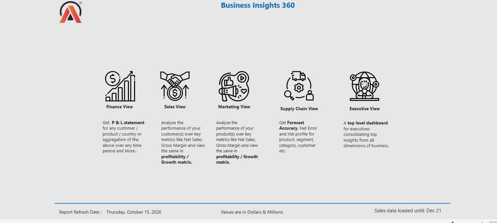
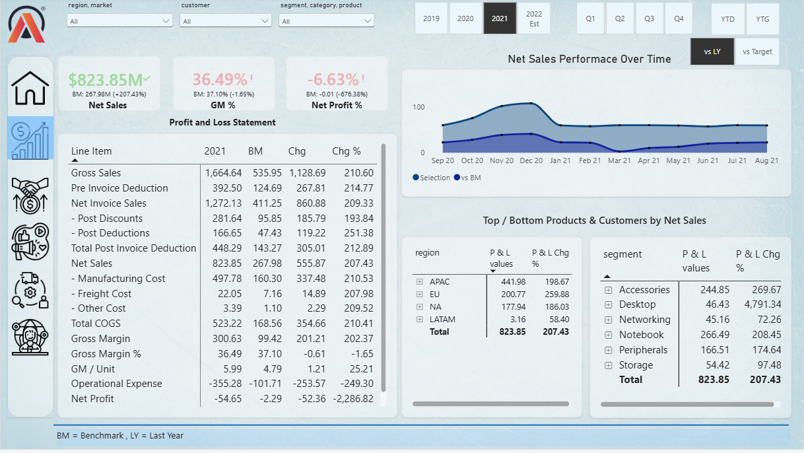
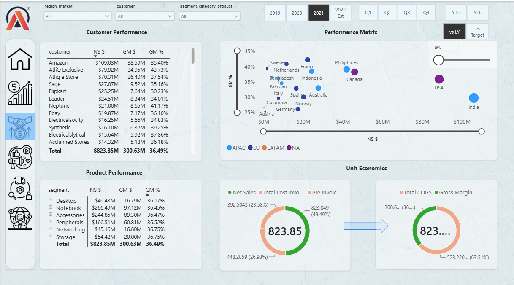
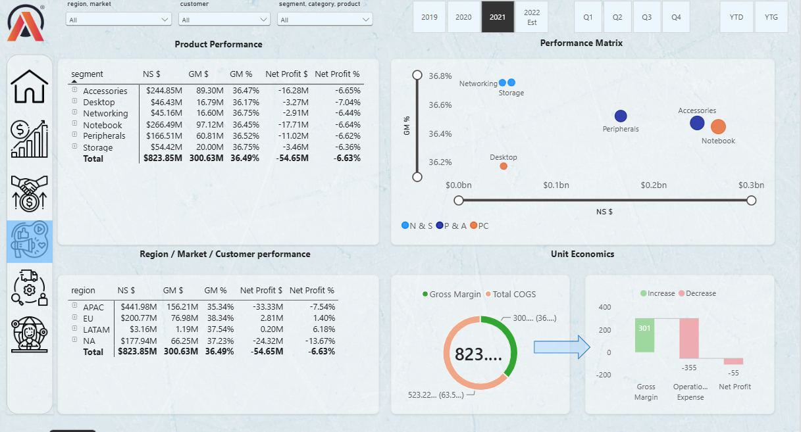
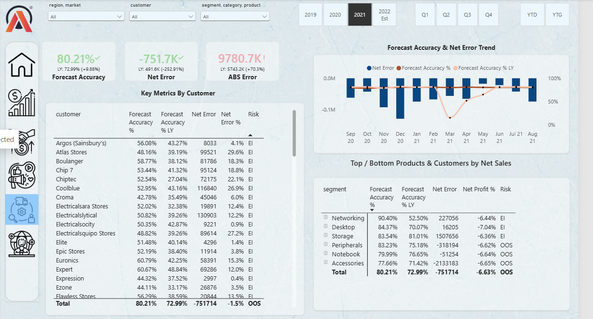
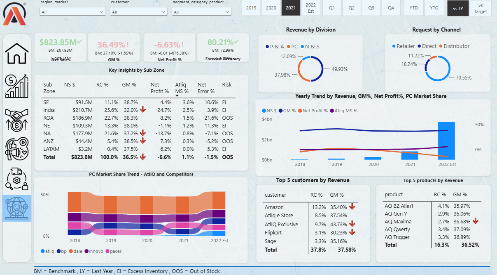

# Business Insights 360 — Power BI Dashboard

An end-to-end Power BI report for **AtliQ Hardware**, a computer hardware and peripherals company that sells through retailers, its own direct channels and distributors in APAC, EU, North America and LATAM.

The report gives each department its own view: Finance, Sales, Marketing, Supply Chain and Executive. It helps the business move away from Excel-based reporting and make faster, data-backed decisions.

> 📥 **Download the .pbix file:** [Google Drive link](https://drive.google.com/file/d/1_yw2DN0qAPvHudjCSkIJgci0N2uZvGi-/view?usp=sharing). The file is about 278 MB, which is over GitHub's 100 MB limit.

---

## 🧭 Report Views

### Home
Navigation page linking to all five views.


### 💰 Finance View
- A P&L statement for any customer, product, market or time period, compared against last year or the target
- Net Sales trend over time against the benchmark
- Top and bottom markets and segments by P&L change



### 🤝 Sales View
- Customer and product performance by Net Sales, Gross Margin $ and GM %
- A performance matrix (Net Sales vs GM %) by market to spot profitable markets that are growing
- Unit economics from gross sales through deductions to gross margin



### 📣 Marketing View
- Segment and region performance down to Net Profit
- A profitability matrix by segment and division
- Unit economics: Gross Margin → Operational Expense → Net Profit



### 🚚 Supply Chain View
- Forecast Accuracy, Net Error and ABS Error compared with last year
- A risk flag for each customer and segment: **EI** (Excess Inventory) or **OOS** (Out of Stock)
- Monthly trend of Net Error and Forecast Accuracy



### 🌐 Executive View
- Top-line KPIs: Net Sales, GM %, Net Profit % and Forecast Accuracy
- Key insights by sub-zone, revenue split by division and channel
- A 5-year trend with a 2022 estimate, PC market share against competitors
- Top 5 customers and products



---

## 🔍 Key Insights (FY 2021)

| Metric | Value |
|---|---|
| Net Sales | **$823.85M** (+207% vs last year) |
| Gross Margin % | **36.49%** (down 1.65% from 37.10%) |
| Net Profit % | **-6.63%** |
| Forecast Accuracy | **80.21%** (up from 72.99%) |

1. **Revenue tripled, but the business ran at a loss.** Gross margin was $300.6M while operational expense was $355.3M, which left a net loss of $54.65M. Growth came at a high operating cost.
2. **APAC drives the business.** It brings in $441.98M, or 54% of net sales. India alone accounts for $210.7M (25.6%), but it has the weakest net profit at -24.7%.
3. **Only EU (+1.4%) and LATAM (+6.2%) were profitable.** North America lost the most in absolute terms at -13.7%.
4. **Customers are concentrated.** Amazon is the largest customer at 13.2% of revenue, followed by AtliQ Exclusive (9.7%) and AtliQ e Store (8.5%).
5. **Retailers dominate sales** at 70.55%, against 18.24% for Direct and 11.22% for Distributors. Peripherals & Accessories is the largest division at 49.93% of revenue.
6. **Forecast accuracy improved by 7 points,** but overall the company carries an Out-of-Stock risk. Accessories and Peripherals are under-forecast.

---

## 🛠️ Tools & Skills

- **Power BI Desktop**: data modeling, report design, bookmarks and page navigation
- **Power Query**: data cleaning and transformation
- **DAX**: calculated columns and measures for the P&L, GM %, Net Profit %, Forecast Accuracy, Net Error and LY/Target comparisons
- **Data modeling**: star schema with fact tables (sales, forecast, costs) and dimension tables (customer, product, date)
- **Business knowledge**: P&L structure, supply chain metrics, fiscal-year calendar (September to August)

---

## 📁 Repository Structure

```
├── README.md
├── 01_home.png
├── 02_finance_view.png
├── 03_sales_view.png
├── 04_marketing_view.png
├── 05_supply_chain_view.png
└── 06_executive_view.png
```

---

## 🙏 Acknowledgement

The project is based on the AtliQ Hardware case study from the **Codebasics** Data Analytics Bootcamp. AtliQ Hardware is a fictional company.

## 📬 Connect

**Nancy Pandey** · [LinkedIn](https://www.linkedin.com/in/nancy0/)
